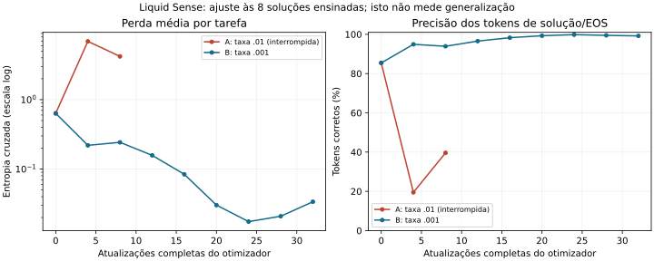

# Treino supervisionado de todos os pesos de texto — estudo015

A autorização explícita do usuário para gradientes/backpropagation permitiu ajustar todos os pesos ativos de texto. O objetivo deste estudo é especializar o modelo nos oito problemas HumanEval já escolhidos no014. Isso não produz uma avaliação independente do HumanEval nem evidencia superioridade sobre modelos maiores.

| Modelo | HumanEval ensinado | MBPP diagnóstico | Controles | NLL linguagem |
|---|---:|---:|---:|---:|
| Qwen original | 1/8 | 0/8 | 10/12 | 3.186716 |
| Liquid Sense principal | 1/8 | 0/8 | 10/12 | 3.183729 |
| Edição014 (rejeitada) | 1/8 | 1/8 | 9/12 | 3.202092 |
| Liquid Sense SFT015 especialista | 6/8 | 0/8 | 2/12 | 3.179255 |

A base nominal é Qwen3.5-0.8B; o híbrido ampliado carrega1.020.252.592 parâmetros únicos, incluindo visão. São919.659.696 parâmetros ativos de texto e100.592.896 de visão.

Foram elegíveis 546 tensores/919,659,696 parâmetros de texto. Na tentativa B, 546 tensores receberam gradientes não nulos; a comparação binária confirmou mudança em 546 tensores e 476,003,334 valores. Os153 tensores de visão permaneceram idênticos. Isso não significa que exista um subconjunto conhecido dedicado exclusivamente à programação.

Tentativa B: Adafactor com taxa relativa .001, batch2, 32 atualizações/8 épocas. A tentativa A com .01 foi interrompida após11 atualizações e degradação da perda de treino; seus logs/fontes estão preservados, mas seus pesos intermediários em memória não foram salvos e não receberam nota de geração. A mudança de taxa constitui uma revisão declarada do protocolo inicial.

Teacher forcing: {'initial': {'mean_task_nll': 0.6344808898020796, 'correct_tokens': 938, 'total_tokens': 1098, 'minimum_gold_margin': -14.5625}, 'final': {'mean_task_nll': 0.033796906951895314, 'correct_tokens': 1089, 'total_tokens': 1098, 'minimum_gold_margin': -10.25}}. Programas gerados literalmente iguais às soluções ensinadas: 5/8. Esses diagnósticos medem ajuste aos exemplos; a pontuação na tabela vem da execução dos programas gerados livremente.

A arquitetura mantém32 camadas físicas,56 execuções por token,24 camadas intermediárias visitadas duas vezes, mHC com dois fluxos, convoluções de sete posições e atenção local256. Os ganhos de visita continuam positivos e normalizados. A auditoria registra ganhos e normas dos roteadores; presença ou mudança desses mecanismos não prova raciocínio melhor.

Condições: mesmos enunciados, tokenizer, BF16, cache, kernels eager, geração gulosa/seed0, thinking desligado, quatro threads e limite320 tokens para código/64 para controles. Nenhuma solução privada ou teste foi inserido nos prompts de avaliação. Exemplos públicos dos enunciados continuam presentes. Os programas não foram reparados; o extrator e os gabaritos são os mesmos do014. Não há igualdade de FLOPs entre original e híbrido. As referências original/pai foram reutilizadas do014 e seus hashes foram verificados; tempos entre sessões não demonstram aceleração.

HumanEval:32,39,75,114,119,129,132,147. MBPP:129,239,245,247,306,392,407,463. São subconjuntos de oito tarefas, não benchmarks completos. MBPP ficou fora do treino, mas seus resultados já tinham sido observados no014; não é um teste final inédito e não foi usado para selecionar estes pesos. Os antigos conjuntos reservados continuam fechados.

Comparações pareadas: {'target': {'task_gains': ['HumanEval/39', 'HumanEval/75', 'HumanEval/114', 'HumanEval/119', 'HumanEval/132'], 'task_losses': [], 'lost_test_groups': 0, 'output_changed': ['HumanEval/32', 'HumanEval/39', 'HumanEval/75', 'HumanEval/114', 'HumanEval/119', 'HumanEval/129', 'HumanEval/132', 'HumanEval/147'], 'delta_pass_at_1_pp': 62.5, 'exact_one_sided_p': 0.03125, 'paired_bootstrap_95_ci_pp': [25.0, 100.0]}, 'transfer': {'task_gains': [], 'task_losses': [], 'lost_test_groups': 3, 'output_changed': ['MBPP/129', 'MBPP/239', 'MBPP/245', 'MBPP/247', 'MBPP/306', 'MBPP/392', 'MBPP/407', 'MBPP/463'], 'delta_pass_at_1_pp': 0.0, 'exact_one_sided_p': 1.0, 'paired_bootstrap_95_ci_pp': [0.0, 0.0]}}. Os intervalos/p-valores são apenas descritivos destes pequenos conjuntos. Significância no conjunto ensinado não comprova generalização.

Controles perdidos: ['dev_0', 'dev_2', 'dev_3', 'reason_product', 'reason_order', 'reason_subtract', 'lang_past', 'lang_translate']; ganhos: []; variação da NLL de linguagem: -0.004475. Os textos completos preservam a distinção entre falha de formato e falha semântica; o gabarito exato não foi ajustado.

O contraexemplo de quadrado mágico já conhecido foi avaliado separadamente. Seu resultado está em known_counterexample.json e não altera os três testes oficiais do MBPP.

Decisão: `experimental_target_specialist_preserved`. O principal continua `rsi100/checkpoints/best.pt`; o especialista é experimental e separado. Todos os pesos do especialista são recuperáveis por XOR binário sem perdas contra o pai imutável, com hashes por tensor/parte e verificação de restauração a frio. Não se infere melhoria geral, aprendizado de pensamento ou desempenho contra4B a partir desta especialização.

Reprodução, estado e hashes: supervised015/attempt_b/REPRODUCE.md, summary.json, integrity.json e checkpoints/final/manifest.json. Todos os relatórios e checkpoints anteriores foram preservados.
