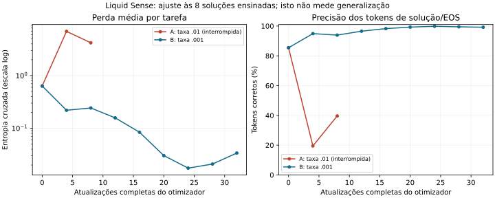

# Liquid Sense — especialização supervisionada dos pesos de texto

Especialista selecionado: **attempt_c**. O checkpoint principal geral permanece preservado e selecionado. Os resultados abaixo vêm de geração livre sem soluções/gabaritos nos prompts de avaliação.

| Modelo | HumanEval ensinado | MBPP diagnóstico | Controles exatos | NLL linguagem |
|---|---:|---:|---:|---:|
| Qwen original | 1/8 | 0/8 | 10/12 | 3.186716 |
| Liquid Sense principal | 1/8 | 0/8 | 10/12 | 3.183729 |
| Edição014 rejeitada | 1/8 | 1/8 | 9/12 | 3.202092 |
| SFT B: todos os pesos de texto | 6/8 | 0/8 | 2/12 | 3.179255 |
| SFT C: refinamento de tokens críticos | 7/8 | 0/8 | 3/12 | 3.194581 |

Os oito problemas HumanEval foram ensinados deliberadamente e já eram observados. Isso é ajuste/especialização, possivelmente memorização, e não uma pontuação limpa de HumanEval, validação independente ou inteligência geral. Não são benchmarks completos. MBPP ficou fora do treino, mas já era observado no014 e em B; não é um teste final inédito. Os conjuntos reservados anteriores permanecem fechados.

Com autorização explícita para gradientes, foram treinados546 tensores/919.659.696 parâmetros ativos de texto. A comparação binária do especialista escolhido contra o principal encontrou mudança em 546 tensores/481,958,751 valores; não se somam contagens de etapas que podem alterar as mesmas coordenadas. Não existe uma partição conhecida exclusivamente dedicada à programação. Os153 tensores de visão permaneceram idênticos em valores; sua capacidade funcional visual não foi testada.

A base nominal é Qwen3.5-0.8B e o híbrido ampliado carrega1.020.252.592 parâmetros únicos. Mantém32 camadas físicas,56 execuções,24 camadas centrais visitadas duas vezes, mHC com dois fluxos, convoluções7 e atenção local256. Os ganhos de visita continuam positivos/normalizados e os roteadores foram treinados. Presença ou alteração de um mecanismo não prova pensamento melhor nem benefício causal do segundo loop.

A tentativa A com taxa relativa .01 foi interrompida após11 atualizações completas e forte aumento da perda de treino. Seus logs/fontes foram preservados, mas seus pesos em memória não foram salvos. A tentativa B partiu do principal, com taxa .001 e32 atualizações/8épocas: alterou476.003.334 valores em546 tensores e acertou6/8 alvos. B permanece integralmente salvo. A revisão da taxa foi declarada no protocolo.

C partiu do snapshot exato B, com taxa .0005 e 6 atualizações adicionais. Todos546 tensores de texto continuaram elegíveis. A supervisão se concentrou no primeiro token canônico divergente por tarefa, com prefixo truncado: inicialmente poly em vez de True, e temp em vez de if. Cada decisão, margem antes do ajuste e atualização está nos logs. Prefixos corretos apareceram no treino; a avaliação recebeu apenas os enunciados. Identificar uma divergência ou seguir seu gradiente não identifica um peso único causador do erro.

A regra congelada aceita C somente com ganho de tarefas completas e nenhuma perda das tarefas corretas de B. Resultado: experimental_benchmark_specialist_c_preserved. Comparação C/B no alvo: {'task_gains': ['HumanEval/32'], 'task_losses': [], 'lost_test_groups': 0, 'output_changed': ['HumanEval/32', 'HumanEval/39', 'HumanEval/129'], 'delta_pass_at_1_pp': 12.5, 'exact_one_sided_p': 0.5, 'paired_bootstrap_95_ci_pp': [0.0, 37.5]}. Resultados MBPP/controles não escolheram as atualizações. Os testes/gabaritos não foram corrigidos nem os programas reparados.

A especialização teve regressões mensuráveis. Em B, parte das falhas de controle contém a resposta correta seguida de repetições ou tags: Sb, Santiago, heart,56,Ana e água. Há também erros de conteúdo:17 menos5 virou15 e o passado simples de go virou have gone/have been. O gabarito exato e a nota2/12 permanecem. A NLL de linguagem ligeiramente menor coexistiu com pior comportamento de geração; ela não comprova retenção geral. Os textos C e as perdas de controles estão nos resultados completos.

Controles anteriormente corretos perdidos: {'b': ['dev_0', 'dev_2', 'dev_3', 'reason_product', 'reason_order', 'reason_subtract', 'lang_past', 'lang_translate'], 'c': ['dev_0', 'dev_2', 'dev_3', 'reason_product', 'reason_order', 'reason_subtract', 'lang_translate']}. Nenhum especialista é promovido como substituto geral; o principal permanece rsi100/checkpoints/best.pt, SHA256 46f6697cd260e5055280b6f6427896d8df1cfd00cb8b2c3bbbf8586e4fa5fae8. Não há comparação executada contra4B nem evidência de superioridade sobre modelos maiores.

Condições iguais para os modelos: mesmos enunciados/contexto, tokenizer, BF16/eager/cache, geração gulosa/seed0, thinking desligado, quatro threads,320 tokens para código e64 para controles. Originais/pai foram reutilizados do014 com hashes verificados; não foram repetidos. Qwen original executa24 camadas, os híbridos56: não há igualdade de FLOPs. Os tempos entre sessões não provam aceleração.

HumanEval:32,39,75,114,119,129,132,147. MBPP:129,239,245,247,306,392,407,463. Exemplos públicos já pertencentes aos enunciados permanecem; soluções privadas/testes não são entradas da geração. Usam-se o executor isolado e testes oficiais selecionados do014. O contraexemplo conhecido de quadrado mágico é diagnóstico separado, sem alterar os três testes oficiais. Atribuições/licenças estão em supervised014/NOTICE.md.

Cada snapshot foi restaurado a frio com todos546 hashes de texto conferidos,699 tensores finitos e153 tensores de visão inalterados. B é um XOR comprimido contra o principal; C é um XOR contra B. C precisa de TODAS as partes de ambos os snapshots, nessa ordem. Os manifests têm hashes por tensor/parte e do stream. O formato preserva os bits exatos; o otimizador/RNG também estão salvos. Não chame make_native/configure_loops após a restauração.

Pesos selecionados: [manifest](../attempt_c/checkpoints/final/manifest.json). [Reprodução C](../attempt_c/REPRODUCE.md), [reprodução B](../attempt_b/REPRODUCE.md), [relatório completo B](../attempt_b/REPORT.md), [resultados e seleção](summary.json), [método](../METHOD.md). As verificações remotas por Git blobs e refs ficam em supervised015/artifact_verification.json.

